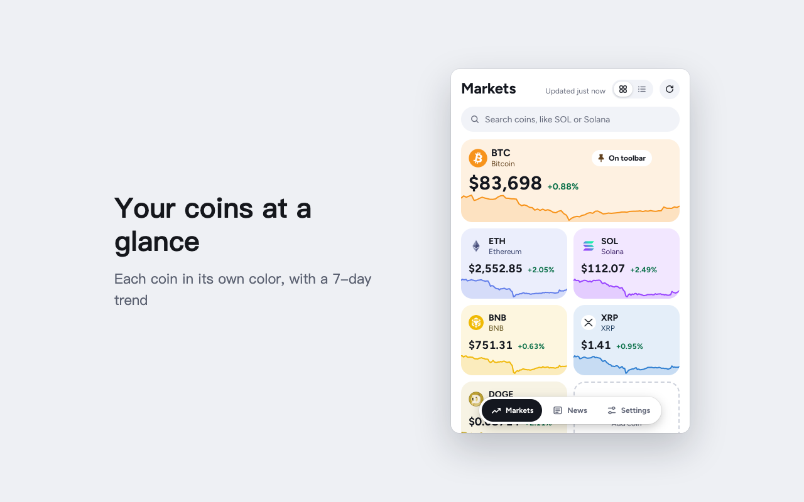

# Crypto Price Viewer

[](https://github.com/TuYv/CryptoPriceViewer)
[](./LICENSE)

**English** · [中文](./README-zh.md) · [日本語](./README-ja.md) · [한국어](./README-ko.md)

A Chrome extension that shows prices for the coins you follow as soon as you click its toolbar icon. You can pin one coin so its price stays on the toolbar icon, and there is a crypto news timeline too.



## Features

**Markets**
- Each coin is a tile in its own brand color, with its 7-day trend drawn underneath
- The coin pinned to the toolbar takes a full row
- The button next to the title switches between tiles and a compact list. The list shows one coin per row, with the pinned coin first
- Drag tiles to reorder them. The “⋯” menu on each tile can pin it, open details, move it to the top or remove it, and you can undo a removal for 5 seconds
- Search shows results as you type; use ↑ and ↓ to choose and Enter to add
- When CoinGecko limits requests or you are offline, the last prices stay on screen with the time they are from

**Coin details**
- Price charts for 1 day, 7 days, 30 days, 90 days and 1 year, with the high and low marked; hover to see the price at any point
- Market cap, 24h volume, circulating supply, all-time high (and how far below it the price is now), market cap rank
- News about the coin

**Toolbar icon**
- Shows the pinned coin’s price or 24h change
- Colored by your price color setting; hover the icon to see the coin, price and change
- Refreshes in the background at the interval you choose

**News**
- A timeline grouped by day; show only news about your coins, or about one coin
- When several sites report the same story, only the earliest one is shown
- The extension doesn't visit any news site until you open the News tab. PANews and Odaily show up right away; Decrypt asks for your OK first
- Switch to Key dates to see when the next Fed rate decision, CPI, jobs report, PCE and GDP come out, each with a plain-language note on what it is, why it matters and how to read the result. After a release, related headlines are shown under it

**Settings**
- Currency: US dollar, Chinese yuan, euro
- Language: 简体中文, English, 日本語, 한국어; follows the browser by default
- Price colors: red up / green down, green up / red down, red up / blue down. The default follows the usual style for your language (red up for Chinese, red up / blue down for Korean, green up for Japanese and English)
- Appearance: system, light, dark
- Optional free CoinGecko API key, which makes rate limits less likely
- Your coin list syncs across computers signed in to the same Chrome account

## Install

- **Chrome Web Store**: search for “Crypto Price Viewer”.
- **Build it yourself** (needs Node.js 22 or newer):

  ```bash
  git clone https://github.com/TuYv/CryptoPriceViewer.git
  cd CryptoPriceViewer
  npm install
  npm run build
  ```

  Open `chrome://extensions`, turn on Developer mode, click “Load unpacked” and choose the `.output/chrome-mv3` folder.

When you upgrade from 0.1.x, your coins, pinned coin, currency, language and refresh interval are kept.

## Where the data comes from

- **Prices**: the public [CoinGecko](https://www.coingecko.com/) API.
- **Key dates**: the release schedules published by the [Federal Reserve](https://www.federalreserve.gov/monetarypolicy/fomccalendars.htm), the [Bureau of Labor Statistics](https://www.bls.gov/schedule/news_release/) and the [Bureau of Economic Analysis](https://www.bea.gov/news/schedule). The dates are built into the extension and updated with new versions; the explanations are written for this extension.
- **News**: [PANews](https://www.panewslab.com/), [Odaily](https://www.odaily.news/) and [Decrypt](https://decrypt.co/). The extension only shows headlines and links; articles open on the original site, and their copyright belongs to each site. You can turn off any source in Settings › News sources.

## Privacy

- No personal information is collected or uploaded; no analytics, no ads
- Settings are kept in Chrome’s own sync storage and only sync within your Chrome account
- Your CoinGecko API key stays on this computer
- The extension only connects to CoinGecko and, once you have opened the News tab, the news sites you have turned on

See the full [privacy policy](./privacy-policy.html).

## Feedback

Report problems or suggest ideas on [GitHub Issues](https://github.com/TuYv/CryptoPriceViewer/issues).

## Development

See [DEVELOPMENT.md](./DEVELOPMENT.md).

## License

[MIT](./LICENSE)
